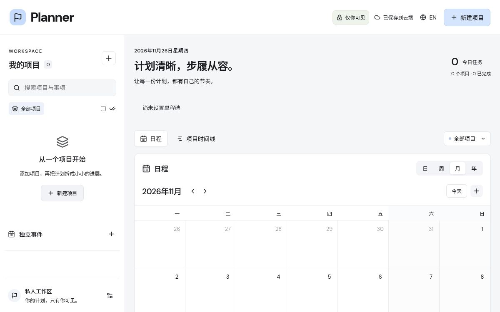

# Planner

个人项目规划 Web App：在同一处管理项目、任务、事件与里程碑，并通过日历和甘特图查看安排。支持中英文、手机主屏幕安装和仅本人可访问的云端保存。

[打开私有站点](https://daymark-planner-20261126.diotimachang.chatgpt.site)

> 此仓库是完整源码备份。访问线上站点需要获得 Sites 访问权限；知道网址或拥有源码不等于能读取线上计划。

## 界面预览

### 桌面工作区

下面是真实站点的空白工作区截图，展示左侧录入栏与右侧月历，不含个人计划内容。



### 86 色预设

下图直接由应用使用的 HEX 数据生成。色系从红、橙、黄到绿、青、蓝、紫排列，中性色单独放在最后；每组按感知亮度从浅到深排列。


## 开始使用应用

1. 打开上面的站点，用拥有访问权限的 **ChatGPT 账号**登录。Sites 负责登录验证，应用不另外保存密码。
2. 点击右上角“新建项目”，填写名称、起止日期，以及主题色和里程碑旗帜颜色。
3. 点击左侧项目名称右边的 **＋**，选择任务、事件或里程碑。
4. 点击任一事项即可编辑标题、日期、备注和颜色。备注中的 HTTP / HTTPS URL 会成为可点击链接。
5. 使用日历的日、周、月、年视图，或切换到“项目时间线”查看甘特图。
6. 添加或修改后自动保存。顶部出现“已保存到云端”表示该次修改已成功写入。

首次进入时可能显示带有“示例工作区”标签的示例内容。点击“开始我的计划”并确认，即可清空示例。只有被标记为示例的数据才会显示此入口。

### 项目与事项

| 类型 | 用途 | 日期和状态 |
| --- | --- | --- |
| 项目 | 汇总一个课题或目标 | 有独立的开始、结束日期；甘特图显示项目周期 |
| 任务 | 一段时间内要完成的工作 | 支持跨日；可勾选完成 |
| 里程碑 | 项目中的重要截止点 | 单日；用项目旗帜颜色显示；可标记完成 |
| 事件 | 会议、预约或其他日程 | 支持日期范围和可选时间；可以属于项目，也可以独立存在 |

项目周期由项目设置决定，不会自动因某个任务超出日期而改变。日期按设备本地日历日期处理，事件时间是本地钟表时间，不自动换算时区。

### 布局与筛选

- **手机，宽度不超过 860 px：** 底部切换“总览 / 日历 / 甘特图”。
- **普通桌面：** 左侧固定项目录入与列表，右侧用 Tab 切换日程和项目时间线。
- **超宽屏，宽度至少 1800 px：** 同时展示日历和甘特图。
- 点击项目名称筛选该项目；“全部项目”恢复全部显示。
- 搜索框按项目名称、事项标题和备注筛选。
- 勾选列表上方的完成筛选框，可以显示已完成事项。
- 顶部里程碑卡片显示各项目最近一个未完成里程碑；逾期的里程碑会保留提醒。

### 选色

打开编辑表单中的“预设颜色”，点击圆点即可选色。当前选色有外圈和勾选标记，鼠标悬停可查看 HEX；也可直接输入自定义六位 HEX，例如 `#92A8D1`。

五张原始色卡包含 89 个色号记录，去重后为 **86 色**。`#737373`、`#8E7986`、`#DDB02E` 各重复一次。原始分图转录保存在 [src/palette.js](src/palette.js)，可追溯和修改。

项目主题、任务、事件、里程碑以及项目旗帜使用同一套预设。已有记录的颜色不会因预设变更而重写。正文仍使用黑色；甘特任务条使用半透明底色，保证深色主题上的文字可读。

### 手机安装

- iPhone：在 Safari 分享菜单中选择“添加到主屏幕”。
- Android：在支持的浏览器菜单中选择“安装应用”或“添加到主屏幕”。

这是可安装的 Web App，不需要应用商店安装包。云端读取和保存需要联网；Service Worker 不缓存私人计划，不提供离线写入队列。

## 在本地运行源码

### 环境要求

- **Node.js 24 或更新版本**，测试使用内置 `node:sqlite`。
- npm 与 Git。
- 浏览器。

```bash
git clone https://github.com/Raining-Sunshine/Personal-Research-Planner.git
cd Personal-Research-Planner
npm ci
npm run dev
```

打开终端输出的本地 URL，通常为 `http://localhost:5173`。私有仓库克隆需要对应的 GitHub 权限。

**本地开发使用独立的预览模式：** Vite 的 `/api/state` 中间件返回预览标记，数据保存在当前浏览器的 `localStorage`。它不访问生产数据库，也不模拟真实登录。顶部会显示“本地预览”。清除浏览器数据会删除本地预览记录。

在托管的 Codex Cloud 环境中，使用该环境提供的预览守护进程，不另起服务：

```bash
sites-preview start /workspace/sites/daymark
```

如果仓库位于其他路径，请替换为实际绝对路径。

### 常用命令

| 命令 | 作用 |
| --- | --- |
| `npm ci` | 按锁文件安装依赖 |
| `npm run dev` | 启动本地界面预览 |
| `npm test` | 执行日期逻辑和 API 防护测试 |
| `npm run build` | 构建浏览器资源与可部署 Worker |
| `npm run db:generate` | 数据库 schema 修改后生成新迁移 |
| `npm run docs:previews` | 根据真实预设数据重新生成 README 色板图 |

## 仓库结构

```text
src/
  main.jsx                 页面、表单、三种视图与自动保存队列
  style.css                桌面、超宽屏和手机样式
  i18n.js                  中英文文案
  model.js                 日期逻辑、示例数据、严格校验与字段规范化
  palette.js               原始 HEX、去重、色系和亮度排序
  server.js                Worker 请求处理、身份检查和 D1 存储
public/
  manifest.webmanifest     主屏幕应用配置
  icon.svg                 应用图标
  sw.js                    不缓存私人数据的 Service Worker
db/schema.ts               D1 表结构
drizzle/                   SQL 迁移和 Drizzle 元数据
scripts/
  build-worker.mjs         打包浏览器资源到 Worker
  generate-previews.mjs    生成文档色板图
tests/                     模型与 API 安全行为测试
docs/previews/             README 预览图片
.openai/hosting.json        Sites 项目 ID 与数据库绑定
vite.config.js             本地开发配置与预览 API
```

关键代码已添加说明，重点解释为什么需要请求序号、revision 条件写入、可信身份头和流式大小限制。

## 登录、保存与基础防护


- **访问权限：** 当前 Sites 站点仅允许拥有者访问。不要为了调试而改成公开访问。
- **用户身份：** 每次读写都要求 Sites 验证并注入的用户 ID；前端传来的 `accountId` 只用于检查会话变化，不能选择要访问的账号。
- **云端保存：** 每个账号保存一个计划文档和递增版本号。数据库记录不会进入 Git 仓库。
- **跨设备同步：** 没有待保存修改时，每 30 秒以及重新聚焦页面时读取云端更新。
- **并发保护：** 旧版本写入返回 409，保存队列停止，避免覆盖其他设备的新修改。界面提示导出备份并重新读取。
- **请求检查：** 写入必须来自同源、使用 JSON；不开放跨域写入。
- **频率与体积：** 按账号每分钟最多 60 次写请求；正文按字节流限制为 2 MB；拒绝无效日期、颜色、字段类型和引用。
- **隐私缓存：** 数据接口使用 `no-store`；Service Worker 不缓存计划。
- **退出登录：** 在“账号与隐私”中退出。有未保存修改时先完成保存，避免丢失工作。

身份头仅可在可信 Sites 入口后使用。如果迁移到其他托管平台，必须接入新的可信身份验证，不能直接信任外部请求中的同名头。

## 构建和部署到 Sites

此仓库的 `.openai/hosting.json` 已绑定现有 Planner 站点，逻辑 D1 绑定名是 `DB`。更新现有站点时保留项目 ID；创建另一个独立站点时应先注册新 Site，再使用它返回的新 ID。

```bash
npm test
npm run build
```

构建结果：

```text
dist/client/          HTML、CSS、JS 和 PWA 文件
dist/server/index.js  default.fetch Worker，内嵌客户端资源
dist/.openai/         构建时复制的托管配置
dist/drizzle/         构建时复制的数据库迁移
```

**推荐通过 Sites 的发布工作流部署**：同步源码到对应 Site 的源码仓库，构建并打包该提交，再保存版本并执行私有发布。GitHub 备份仓库的推送本身不会自动更新 Sites。

需要手工检查归档时，可在项目根目录执行：

```bash
tar -czf /tmp/planner-deploy.tar.gz \
  .openai/hosting.json dist/server dist/client drizzle
```

归档根目录必须保留 `dist/server/index.js` 路径；不要只把 `dist/` 里面的内容放到归档根目录。代码是 Worker 模块，不能当作普通 Node HTTP 服务直接启动。生产运行时需要 Sites 提供认证入口和 `DB` 绑定。

### 数据库修改

1. 修改 `db/schema.ts`。
2. 运行 `npm run db:generate`。
3. 检查生成的 SQL 仅包含需要的 schema 变化。
4. 提交 SQL、快照与 journal，运行测试和构建，再通过 Sites 发布。

已应用的迁移不可重写。追加新迁移，不在请求处理代码中建表，也不在迁移里写入演示计划。

## 备份和恢复

### 源码备份

GitHub 保存应用源码、锁文件、构建脚本、测试、数据库 schema / 迁移、PWA 文件、预览图片和托管配置。提交历史一并保留。

`node_modules/`、构建产物、开发缓存、凭据和真实计划记录不属于源码备份。`.gitignore` 已排除本地工作目录、环境文件及运行时缓存。不要把令牌、密码或导出的私人计划提交进仓库。

### 计划数据备份

在应用设置中点击“导出备份”，下载 `planner-YYYY-MM-DD.json`。在另一设备或需要恢复时，使用“导入备份”并确认。

导入会**替换当前账号的全部项目和事项**，建议先导出当前数据。恢复后的数据仍需等待顶部显示保存成功。GitHub 源码备份不能代替这份计划数据备份。

## 常见问题

| 情况 | 处理方式 |
| --- | --- |
| 无法打开私有站点 | 用拥有访问权限的 ChatGPT 账号登录；链接本身不授予权限 |
| 显示“本地预览” | 当前使用浏览器本地数据，不会同步到正式站点 |
| 显示保存失败 | 保持页面打开，恢复网络后重试；可先导出备份 |
| 提示其他设备已有更新 | 导出当前修改，再刷新读取云端；不要反复强行覆盖 |
| 操作过于频繁 / 429 | 等待一分钟后重试，当前修改仍留在页面中 |
| 登录已失效 / 401 | 先备份未保存修改，再重新登录 |
| 新增 schema 后数据库失败 | 检查最新部署及迁移结果；不要重写已应用迁移 |

## 预览图维护

`docs/previews/desktop.jpg` 是真实私有站点的空白工作区截图，未包含个人计划。`docs/previews/palette.svg` 是由实际色板数据生成的静态图，不冒充界面截图。

修改色号后运行 `npm run docs:previews` 并提交更新的 SVG。补充界面截图时使用空白或示例工作区，避免带入账号邮箱、访问凭据或真实事项。
