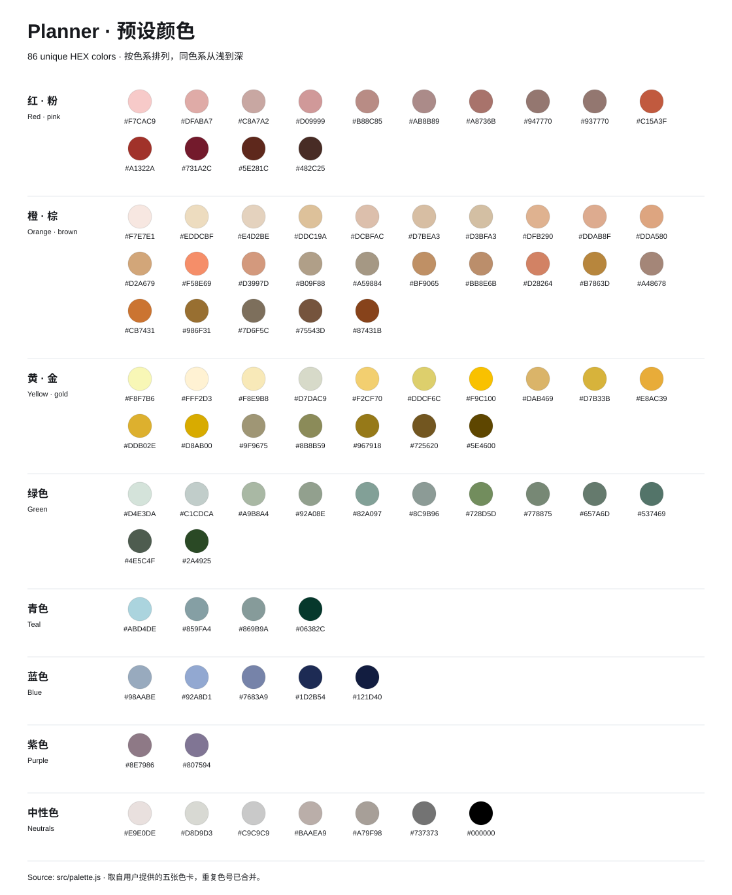

# Planner

English | [简体中文](README.zh-CN.md)

A personal project planner that brings projects, tasks, events, and milestones together in a calendar and Gantt timeline. Includes English and Chinese interfaces, responsive layouts, installable web app support, and private cloud storage when deployed through ChatGPT Sites.

## Preview

An empty workspace from the hosted application, with no personal plans. This screenshot illustrates the layout; some labels and controls have changed since it was captured.


The 86 preset colors below are generated from the same HEX values used by the application. Colors run from red through blue and purple, with neutrals at the end; each family runs from light to dark.



## Features

- Projects with date ranges, tasks, milestone deadlines, and events; events can also exist independently.
- Notes with clickable HTTP/HTTPS links, 86 preset colors, custom HEX colors, and configurable milestone flags. Text stays black.
- Day, week, month, and year calendars, with **Sunday first and Saturday last**; a Gantt view for project ranges, tasks, and milestones.
- Weekly events with multiple weekdays, monthly events, repeat intervals, and optional end dates.
- In-app ICS file imports, Outlook published calendar subscriptions, and optional Microsoft account authorization for accessible calendars, including supported shared calendars.
- Imports can appear **only in the calendar**, or become **events in a chosen project**.
- Account-isolated storage, automatic saving, conflict detection, JSON backup/restore, and phone home-screen installation.

## Use Planner

1. Open your deployed site and sign in with a ChatGPT account that has access. Sites handles authentication; Planner does not store passwords.
2. Create a project, then use the **+** next to its name to add a task, event, or milestone.
3. Edit an item with a mouse click on desktop or a **half-second hold** on touchscreens. Switching views, filtering, marking completion, and adding items remain single-tap actions.
4. Choose a calendar view or the project timeline. The next-milestone cards retain overdue deadlines until completed.
5. Changes save automatically. Wait for **Saved to cloud** before closing the page.

The initial sample workspace is labeled as a demo. Use **Start my workspace** and confirm to clear its sample records.

### Layout and date navigation

| Layout | Behavior |
| --- | --- |
| Phone, up to 860 px | Bottom navigation switches between overview, calendar, and Gantt |
| Desktop | Project sidebar on the left; schedule/timeline tabs on the right |
| Wide screen, at least 1800 px | Calendar and timeline appear together |

On desktop, clicking a month/week date opens its daily agenda; clicking a year-view date opens its month. On touchscreens:

- **Month:** tap once to select a date, then tap the same date again to open its agenda.
- **Week:** tap a date heading once to select it, then again to open its agenda.
- **Year:** tap a date once to select it, then again to open its month with that date selected.

There is no time limit between the two taps. Selecting a different date starts again. Switching day/week/month/year follows the selected date; week/year views scroll the selection into view. Use **+** to create an event; tapping a date does not create one.

Touch editing cancels when the finger moves or the page scrolls. A successful hold requests a short vibration where supported; iPhone/iOS Safari generally does not support the web vibration API. Visual feedback remains available.

### Items, colors, and time

Projects have their own date ranges; tasks outside those ranges do not automatically extend the project. Milestones are single-day deadlines. Events support date ranges and an optional local time. Dates use the device’s local calendar; manually entered times are wall-clock times, not timezone-aware appointments.

Use the color picker’s preset library or a six-digit HEX value such as `#92A8D1`. Project colors and milestone flags share the same palette. Original swatch transcription and sorting live in [src/palette.js](src/palette.js). Changing the preset palette does not rewrite existing records.

### Calendar imports and recurring events

Open **Import calendars**, choose a source and date range, preview the entries, then confirm:

| Source | Setup and refresh |
| --- | --- |
| ICS file | Upload an `.ics` file up to 2 MB; choose the file again to refresh |
| Outlook published ICS/webcal URL | No Microsoft app registration required; refresh manually from the source list |
| Outlook account | Requires a Microsoft app registration and server environment variables; select a calendar exposed to your account through Microsoft Graph |

Imports are read-only snapshots, with up to 366 days and 2,000 occurrences per import, and 5,000 items per plan. Refresh replaces that source’s imported events without duplicating them or changing other sources. Changing its date range removes that source’s old events outside the new range. There is **no background automatic synchronization** and no write-back to Outlook.

Calendar-only imports stay out of the project sidebar and Gantt chart. Project imports appear as events in that project. Edit imported events in their source calendar, then refresh. Removing a source also removes its imported events after confirmation.

Native events support weekly repeats on selected weekdays or monthly repeats, at intervals of 1–12 weeks/months. Monthly repeats use the starting day of the month and skip months without that date. Editing, completing, or deleting applies to the entire series; single-occurrence overrides are not currently supported.

See the [Microsoft registration and Outlook setup guide (Chinese)](docs/outlook-setup.md) for the callback, permission, and environment-variable details. Microsoft authorization cannot work until those settings are configured. ICS imports do not depend on them. Imported timed events are converted to the importing device’s timezone and saved as local wall-clock values; refresh after changing timezones to convert them again. Unknown ICS timezones are rejected rather than guessed.

### Install on a phone

- **iPhone:** Safari → Share → Add to Home Screen.
- **Android:** browser menu → Install app or Add to Home Screen.

This is an installable web app, not an app-store package. Cloud access needs a network connection. The service worker does not cache private plans or queue offline writes.

## Run locally

Requirements: **Node.js 24+**, npm, Git, and a browser. Tests use Node’s built-in `node:sqlite`.

```bash
git clone https://github.com/Raining-Sunshine/Personal-Research-Planner.git
cd Personal-Research-Planner
npm ci
npm run dev
```

Open the URL printed by Vite, usually `http://localhost:5173`.

Local development is a separate **preview mode**: the Vite middleware marks `/api/state` as a preview, and plans are stored in that browser’s `localStorage`. It does not access production records, provide real authentication, or synchronize between devices. Clearing browser storage removes preview data. Hosted Outlook and subscription proxy APIs are not provided by this local preview; ICS file import works locally.

| Command | Purpose |
| --- | --- |
| `npm ci` | Install locked dependencies |
| `npm run dev` | Start the browser-local development preview |
| `npm test` | Run model, navigation, import, and API security tests |
| `npm run build` | Build browser assets and the deployable Worker |
| `npm run db:generate` | Generate a new database migration after schema changes |
| `npm run docs:previews` | Regenerate the palette illustration from source colors |

## Deploy with ChatGPT Sites

1. In a ChatGPT/Codex session with Sites available, provide this repository and ask: **“Deploy Planner with D1 storage and keep the site owner-private.”**
2. For an existing site, retain its project ID. For your own independent copy, let Sites create a new site and replace the project ID in `.openai/hosting.json`; do not reuse the original author’s binding. The publishing workflow synchronizes source, builds, applies migrations, and publishes.
3. Open the returned URL and sign in with an authorized account. For a custom domain, register it with Sites first and add the DNS records Sites returns.

No VPS or manually opened server ports are needed for this route. Pushing GitHub alone does **not** update Sites; publish changes through Sites. Outlook authorization is optional and needs separate configuration.

## Server ports, custom domains, and DNS

See the **[hosting and DNS guide](docs/hosting.md)** ([中文](docs/hosting.zh-CN.md)) for:

- Sites CNAME/TXT records and when **not** to add A/AAAA records.
- VPS A/AAAA records, cloud security groups, host firewall rules, reverse proxying, and HTTPS.
- A private SSH-tunnel preview and an optional password-protected domain preview.
- What must change before running the full app on your own server.

**The current production backend is a Cloudflare Worker using Sites identity and D1.** It is not a standalone Node HTTP server. `node dist/server/index.js` or uploading only `dist/client/` is not a complete production deployment. The VPS examples in the guide run a browser-local development preview; full authenticated cloud storage requires a backend/authentication adaptation.

## Storage, privacy, and backups

The original hosted site is owner-private. Your deployment needs its own access policy. Every production data request requires a user ID verified by the trusted Sites gateway; do not trust externally supplied `oai-authenticated-user-id` headers on another host.

- Each user has an isolated plan document and revision number in D1.
- Idle clients check for updates every 30 seconds and on focus. An outdated write returns a conflict instead of overwriting newer data.
- Writes require same-origin JSON requests, valid data, and the current account. Plan writes are limited to 60 per minute per user and 2 MB per request.
- Private API responses use `no-store`. Microsoft tokens are encrypted server-side and never sent to the browser or included in plan exports.

Use **Settings → Export backup** to save `planner-YYYY-MM-DD.json`. Importing a backup **replaces the current plan**, including its projects and items; export the current data first and wait for successful cloud saving afterward.

GitHub backs up source and migrations, **not your plan data**. Do not commit exported plans, environment secrets, or tokens. ICS subscription URLs can grant calendar access and are included in private JSON backups: keep those files private.

## Repository layout

```text
src/
  main.jsx                 UI, forms, views, and serialized save queue
  CalendarImport.jsx       Calendar connection/import dialog
  calendar-import.js       ICS parsing, Graph conversion, source reconciliation
  calendar-navigation.js   Date selection and activation rules
  edit-gesture.js           Touch editing gesture controller
  useEditGesture.js         React gesture bindings
  recurrence.js            Native recurring-event date calculations
  model.js                 Date helpers, sample data, validation, normalization
  server.js                Worker assets, identity checks, versioned D1 storage
  outlook-server.js        Read-only Microsoft OAuth and bounded ICS proxy
  i18n.js / style.css       Translations and responsive styles
  palette.js               Preset HEX values and ordering
public/                    Manifest, icon, and service worker
db/schema.ts               D1 schema
drizzle/                   Append-only SQL migrations and metadata
scripts/                   Worker build and palette preview generator
tests/                     Model, interaction, calendar, and security tests
docs/                      Hosting and Outlook guides, preview images
.openai/hosting.json        Sites project identity and DB binding
```

The build produces `dist/client/`, `dist/server/index.js`, and copies of hosting metadata/migrations. Change `db/schema.ts`, run `npm run db:generate`, inspect the generated SQL, then test, build, and publish. Do not rewrite applied migrations or put personal/demo records into migrations.

## Troubleshooting

| Symptom | What to check |
| --- | --- |
| Private site cannot be opened | Sign in with an account allowed by that site; a link does not grant access |
| “Local preview” is displayed | Data belongs to this browser and does not sync to production |
| Save failed | Keep the page open, restore connectivity, retry, or export a backup |
| Version conflict | Export unsaved changes, then reload the latest cloud data |
| 401 / expired login | Back up unsaved work, then sign in again |
| 429 / too many updates | Wait one minute before retrying |
| Domain shows 404 | Check domain registration, verification, deployment, and provider routing—not only DNS |
| VPS shows 502 | Check that the local preview process is listening at the proxy’s configured address |

The existing desktop screenshot uses an empty workspace. The palette SVG is generated data, not a UI screenshot. Use empty or sample records for future screenshots and exclude account details and credentials.

## License

Copyright (c) 2026 Yuyang Zhang

This project is licensed under the [Creative Commons Attribution-NonCommercial 4.0 International License (CC BY-NC 4.0)](https://creativecommons.org/licenses/by-nc/4.0/). See [LICENSE](LICENSE).

[](https://creativecommons.org/licenses/by-nc/4.0/)
